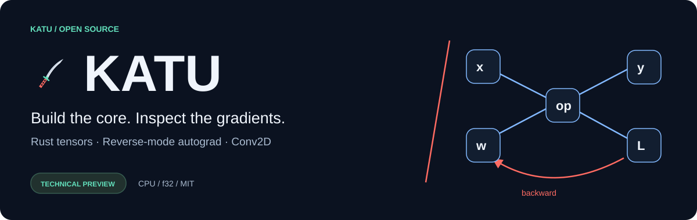
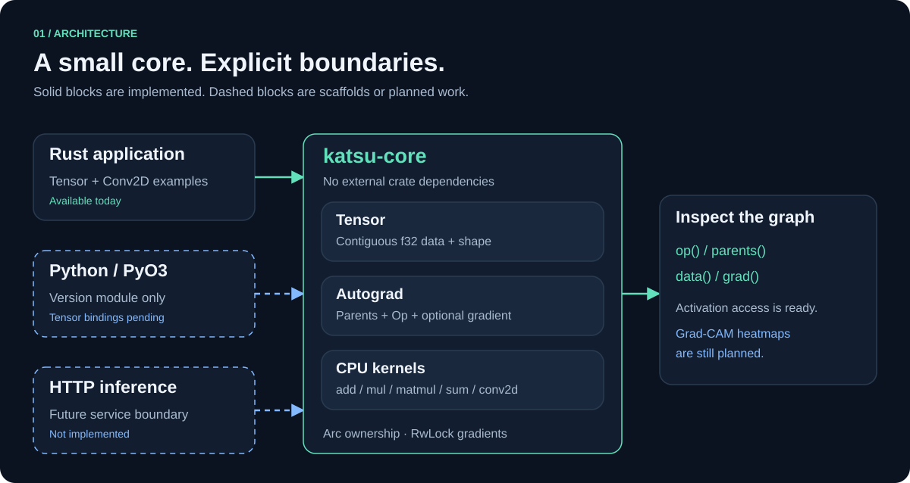

<p align="center"></p>

# Katu

> Until 2026-11-01 this project was called **Katsu**. It was renamed **Katu**, Tupi for "good", because
> `katsu` was already someone else's package on PyPI. Checkpoint and tokenizer files keep their original
> signatures (`KATSUCK1`, `KATSUBP1`, `KATSUBP2`) so every trained model still loads.

**A Rust deep learning core for inspecting operations and gradients.**

[Português](README.md) · [API reference (PT)](docs/api.md) · [Contributing](CONTRIBUTING.md)

Katu is an early technical preview: a Rust CPU core using Rayon with f32
tensors, reverse-mode autograd and NCHW Conv2D. Explainability is a project goal;
activation tensors and their gradients are available, but Grad-CAM is not yet implemented.

## Run it

From a local checkout with Rust/Cargo available:

```sh
cargo test -p katu-core
cargo run -p katu-core --example autograd
cargo run -p katu-core --release --example conv2d
```

Cargo may need network access to resolve the workspace's PyO3 dependency, even
when selecting the core package. See the [offline Cargo instructions](docs/testing.md).

```rust
use katu_core::{Tensor, TensorError};

fn main() -> Result<(), TensorError> {
    let a = Tensor::new(vec![1., 2.], &[2])?;
    let b = Tensor::new(vec![3., 4.], &[2])?;
    let prediction = a.add(&b)?;
    let loss = prediction.mul(&prediction)?.sum()?;
    loss.backward()?;
    println!("loss: {:?}; gradient: {:?}", loss.data(), a.grad()?);
    Ok(())
}
```

Expected loss: `[52.0]`; gradient: `Some([8.0, 12.0])`.
This computes gradients, not a complete training loop.

## Current capabilities

- Contiguous CPU f32 tensors: add, elementwise multiply, matmul and sum.
- Dynamic graphs, seeded VJPs and accumulation across repeated backward calls.
- Conv2D forward and backward, NCHW inputs, OIHW weights, stride and zero padding.
- Graph-connected activation access for future attribution methods.
- SGD optimizer, a minimal `fit` loop, ReLU and per-epoch JSON Lines metrics.
- Broadcasting add/mul, transpose, reshape, softmax, log-softmax, LayerNorm, GELU,
  causal mask, cross-entropy and the Adam optimizer: the building blocks of a transformer.
- Katu LM: a character-level language model trained on 22 Brazilian public-domain books (multi-head attention), with sampling and checkpoints.
- 49 core tests, including finite-difference checks of matrix and convolution gradients.



## Scope and limitations

Arc/RwLock Tensor graph with Rayon and NEON/AVX2 CPU kernels; no GPU. Training uses SGD or Adam with a
fixed rate; no mini-batches. No strided views or higher-order derivatives. Conv2D
has no bias, groups or dilation. Python is a packaging scaffold exposing a
version value, not a Tensor API. Do not expect `pip install katu` to install this project.

Local core tests have passed through rustc. Remote CI and the complete Python
workspace have not been verified. No performance advantage over PyTorch is claimed.
Version metadata is 0.1.0; there is no published release established by this repository.

The detailed documentation is currently in Portuguese:
[start here](docs/README.md). Bug reports and contributions in English or Portuguese
are welcome. See [MIT license](LICENSE), [contribution guide](CONTRIBUTING.md),
[roadmap](docs/roadmap.md) and [changelog](CHANGELOG.md).

See [native scaling](docs/scaling.md) for Rust BPE, batched training and the experimental hybrid CUDA backend. It passed CPU parity on an RTX 4090 (2026-10-31). See [GPU validation](deploy/cuda/README.md) and [native GGUF export](docs/gguf.md).
