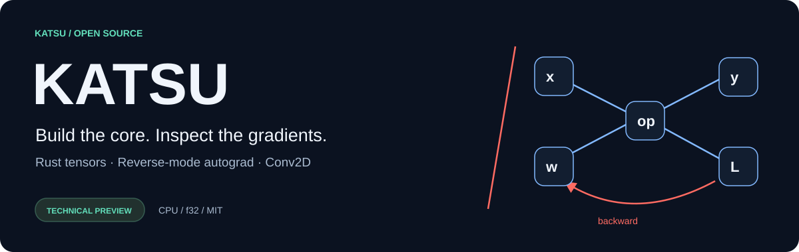
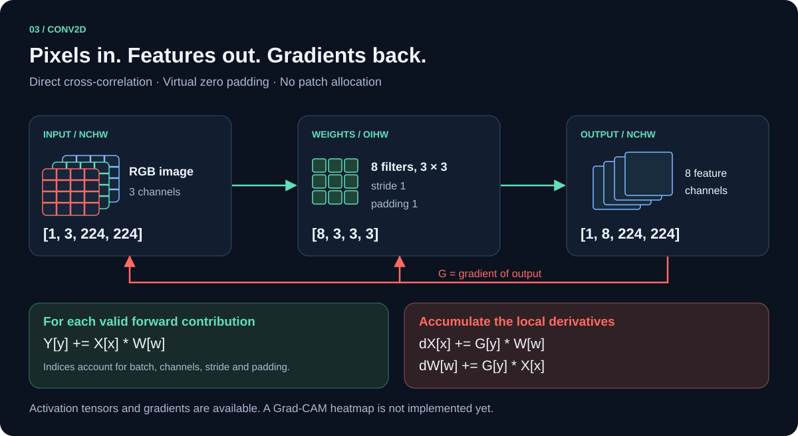
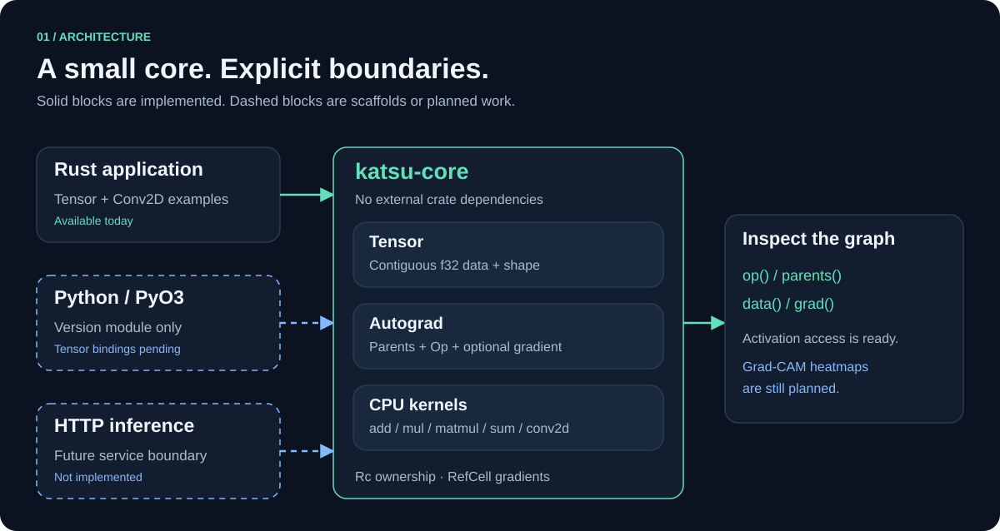

<p align="center"></p>

# Katsu

**Um núcleo de deep learning em Rust, construído para inspecionar operações e gradientes.**

[English](README.en.md) · [Começar](docs/getting-started.md) · [API](docs/api.md) · [Arquitetura](docs/architecture.md) · [Contribuir](CONTRIBUTING.md)

Katsu combina tensores CPU `f32`, diferenciação automática reversa e Conv2D em um
core sem dependências externas. A explicabilidade é uma direção do projeto:
ativações e gradientes já estão disponíveis; Grad-CAM ainda está no roadmap.

> **Prévia técnica · 0.1.0 · MIT.** Há SGD, Adam, broadcasting e as peças de um
> transformer; ainda não há mini-batches, GPU ou classe Tensor em Python. A API pode mudar. Não foram medidos ganhos sobre PyTorch.

## Comece pelo código que funciona

Na raiz de uma cópia local do projeto, com Rust e Cargo no PATH:

```sh
cargo test -p katsu-core
cargo run -p katsu-core --example autograd
cargo run -p katsu-core --release --example conv2d
cargo run -p katsu-core --example train
```

Cargo pode precisar de rede para resolver PyO3, mesmo selecionando apenas o core,
porque ele pertence ao mesmo workspace. Veja a [alternativa offline](docs/testing.md).

```rust
use katsu_core::{Tensor, TensorError};

fn main() -> Result<(), TensorError> {
    let a = Tensor::new(vec![1., 2.], &[2])?;
    let b = Tensor::new(vec![3., 4.], &[2])?;
    let prediction = a.add(&b)?;
    let loss = prediction.mul(&prediction)?.sum()?;
    loss.backward()?;
    println!("loss = {:?}", loss.data()); // [52.0]
    println!("dL/da = {:?}", a.grad()?);  // Some([8.0, 12.0])
    Ok(())
}
```

Esse exemplo calcula uma perda e suas derivadas; não atualiza parâmetros.
O [arquivo executável](crates/katsu-core/examples/autograd.rs) também imprime `dL/db`.

## O que existe hoje

| Área | Implementado | Ainda não implementado |
| --- | --- | --- |
| Tensor | `add`/`mul` com broadcasting, `matmul`, `sum`, `transpose`, `reshape` | Views sem cópia, matmul em lote, outros dtypes |
| Transformer | `softmax`, `log_softmax`, `layer_norm`, `gelu`, `relu`, `causal_mask`, `one_hot`, `cross_entropy` | Atenção multi-cabeça, dropout, embeddings treináveis dedicados |
| Autograd | Grafo dinâmico, VJP, acumulação, `zero_grad`, `retain_grad` | `requires_grad`, detach, derivadas superiores |
| Visão | Conv2D NCHW, stride, padding, dX e dW | Bias, groups, dilation, pooling |
| Explicabilidade | Acesso às ativações e seus gradientes | Grad-CAM e heatmaps |
| Python | Estrutura PyO3/Maturin; módulo de versão | `katsu.Tensor`, wheels publicados |
| Linguagem | Katsu LM: modelo de caracteres em português, geração e checkpoint ([guia](docs/katsu-lm.md)) | Várias cabeças, tokenizer BPE, lote em matmul |
| Treinamento | SGD, Adam, loop `fit`, métricas JSON por época ([guia](docs/training.md)) | Mini-batches, agendamento de lr, gradient clipping |
| Execução | CPU, single-thread, Rust seguro | GPU, paralelismo, backend HTTP |

## Do pixel ao gradiente



O [exemplo RGB 224×224](crates/katsu-core/examples/conv2d/main.rs) usa oito filtros
3×3, stride 1 e padding 1. A saída é `[1, 8, 224, 224]`. A camada registra
entrada e pesos como pais; `loss.backward()` acumula ambos os gradientes.

`get_activation_map()` retorna a saída pré-ativação ligada ao grafo. Ela ainda não
é um heatmap explicativo. Veja [Conv2D e explicabilidade](docs/conv2d.md).

## Um core, um grafo



O core usa `Rc` para compartilhar nós e `RefCell` apenas para os gradientes.
Dados e arestas são imutáveis. `clone()` compartilha o mesmo nó. O motor ainda
não é `Send`/`Sync`. Leia a [arquitetura e os limites](docs/architecture.md).

## Documentação

| Documento | Conteúdo |
| --- | --- |
| [Começar](docs/getting-started.md) | Ambiente, comandos, integração Rust e Python experimental |
| [Referência da API](docs/api.md) | Tensor, Conv2D, Op e todos os erros públicos |
| [Autograd](docs/autograd.md) | Matemática, ordem topológica, VJP e acumulação |
| [Katsu LM](docs/katsu-lm.md) | Primeiro modelo de linguagem do Katsu: treino, geração e checkpoint |
| [Treinamento](docs/training.md) | SGD, loop `fit` e contrato JSON com o monitor arandu |
| [Conv2D](docs/conv2d.md) | Layout, derivadas, cache e caminho para Grad-CAM |
| [Testes e validação](docs/testing.md) | Evidências, reprodução offline, CI e limitações |
| [Roadmap](docs/roadmap.md) | Próximas entregas e critérios de conclusão |
| [Contribuição](CONTRIBUTING.md) | Como propor mudanças e validar kernels |
| [Histórico](CHANGELOG.md) | Mudanças ainda não publicadas |

## Escopo de produção

Katsu é uma biblioteca, não um serviço. Por isso não se aplicam: interface web,
banco de dados, autenticação, deploy com proxy/HTTPS, rate limiting, cache/CDN,
backup e endpoint de métricas. Se um backend HTTP for criado (roadmap), essas
camadas passam a valer. O que se aplica: testes automatizados, CI, hook local
(`.githooks`), dependências fixadas em `Cargo.lock`, erros tipados e um motor
single-thread cujo limite de escala está documentado em [arquitetura](docs/architecture.md).

## Validação e licença

Há **46 testes de integração** do core: 6 de Tensor, 8 de Autograd, 7 de Conv2D, 6 de Treinamento, 11 de operações de transformer e 8 do Katsu LM.
A verificação local via `rustc` passou, incluindo diferenças finitas. O workflow
[GitHub Actions](.github/workflows/ci.yml) está configurado; sua execução remota
não foi verificada. O workspace Python completo ainda não foi validado.

Licença [MIT](LICENSE). Contribuições são bem-vindas; comece pelo
[guia de contribuição](CONTRIBUTING.md). Os SVGs são arquivos vetoriais locais,
editáveis e distribuídos sob a mesma licença do projeto.
