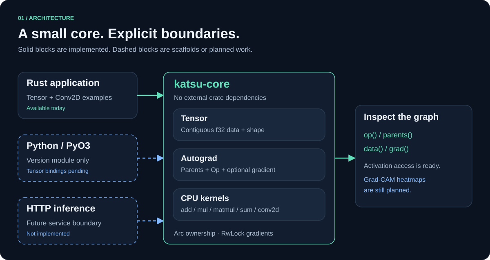

# Arquitetura

[Índice](README.md) · [Código do Tensor](../crates/katsu-core/src/tensor.rs)

## Limites entre módulos

| Local | Responsabilidade | Status |
| --- | --- | --- |
| `crates/katsu-core` | Tensor, grafo, kernels CPU e Conv2D | Implementado |
| `crates/katsu-python` | Extensão PyO3 `_native` | Somente módulo de versão |
| `python/katsu` | Entrada do pacote Python | Reexporta `__version__` |
| `pyproject.toml` | Build Maturin | Configurado; integração não validada |
| Futuro backend HTTP | Serviço de inferência | Não implementado |

O core usa Rayon para kernels CPU paralelos. O workspace resolve também PyO3; isso
explica por que Cargo pode precisar de rede mesmo quando testa só o core.

## Ownership e imutabilidade

`Tensor` encapsula `Arc<TensorNode>`. Cada nó contém `Vec<f32>`, shape,
`RwLock<Option<Vec<f32>>>` para gradientes, `Vec<Tensor>` de pais e `Op`.
Os dados, shapes e pais são privados e imutáveis depois da construção.

- `clone()` incrementa a referência ao mesmo nó; não duplica dados.
- Operações criam novos nós que apontam para nós existentes.
- A API não permite inserir ciclos nem alterar arestas depois do forward.
- Não existem referências de pais para filhos. A liberação ocorre por contagem de referências.
- Conv2D mantém um cache do último input/output. `clear_cache()` libera esses handles;
  outros handles externos continuam válidos.

Essa imutabilidade impede que os valores usados para calcular derivadas locais
sejam alterados entre forward e backward. Uma futura API de treinamento precisa
definir como atualizar parâmetros entre grafos sem invalidar grafos anteriores.

## Execução e memória

Dados em `f32`, CPU e ordem row-major. Matmul usa Rayon e NEON/AVX2;
convolução permanece sequencial. Não há BLAS ou GPU. Broadcasting usa um mapa de índices
por operação; não há views ou strides de armazenamento (transpose e reshape copiam).

O crate declara `#![deny(unsafe_code)]`, com exceção isolada para intrinsics em `simd.rs`. Buffers numéricos usam reserva falível;
Arc, vetores de pais e estruturas auxiliares do grafo usam alocação padrão. Não há
garantia de recuperar qualquer falta de memória; alocações do chamador também
estão fora do tratamento do core.

O Tensor usa Arc/RwLock e é Send/Sync; publicação de gradientes é serializada. A travessia backward e a destruição
do grafo são iterativas: cadeias com centenas de milhares de nós não estouram a pilha.

## Integração futura

Um wrapper PyO3 pode compartilhar Tensor entre threads; Conv2D ainda mantém cache RefCell. A decisão sobre liberar o GIL não está implementada. Um serviço Axum
precisará de uma API de inferência e uma estratégia de isolamento/concorrência.
Essas camadas não devem trazer HTTP ou Python para a matemática do core.

Detalhes dos kernels, batches, BPE e limites da ponte GPU em [Escala](scaling.md).
