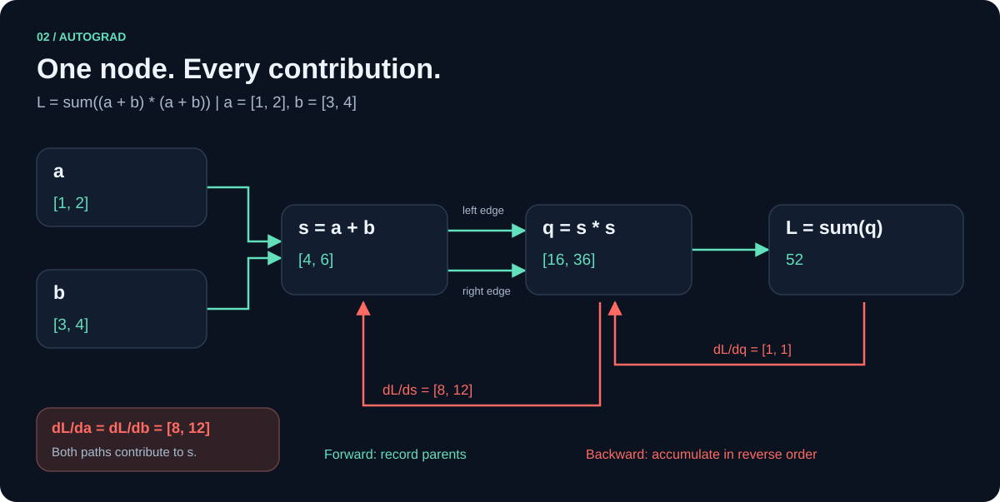

# Autograd reverso

[Índice](README.md) · [Referência](api.md)



## Do forward ao backward

Cada operação armazena `Op` e seus pais no nó de saída. `backward()` inicia o
adjunto da saída em 1 e exige exatamente um elemento, inclusive em shapes como
`[1]`. `backward_with(&seed)` aceita qualquer saída com seed achatado do mesmo tamanho.

O seed define o produto vetor-Jacobiano (VJP): para saída Y e seed v,
calculamos as derivadas de `sum(v * Y)` em relação aos ancestrais de Y.
O seed é constante nesta diferenciação.

1. DFS iterativa constrói a ordem topológica, pais antes dos filhos.
2. Cada nó aparece uma vez, identificado pela identidade Rc, não pelos seus valores.
3. O motor cria adjuntos temporários zerados para os nós alcançáveis.
4. Percorre a ordem reversa e acumula cada contribuição nos pais.
5. Valida os empréstimos dos gradientes e só então publica os resultados.

O mesmo pai pode aparecer duas vezes: em `x.mul(&x)`, as duas arestas contribuem.
Deduplicar nós não significa deduplicar arestas.

## Derivadas locais

| Op | Forward | Propagação de G |
| --- | --- | --- |
| `Leaf` | Dados de entrada | Sem pais |
| `Add` | A+B | dA += G; dB += G |
| `Mul` | A*B elemento a elemento | dA += G*B; dB += G*A |
| `Matmul` | A@B | dA += G@Bᵀ; dB += Aᵀ@G |
| `Sum` | Soma dos elementos de A | dA += G em cada elemento |
| `Conv2D` | Correlação cruzada | [Derivação por índices](conv2d.md) |

## Acumulação entre chamadas

O campo `grad` começa em `None`. Backward preenche as folhas e os intermediários
marcados com `retain_grad()`. Os demais adjuntos são liberados assim que consumidos,
o que reduz o pico de memória.
Uma nova chamada calcula adjuntos do zero e os soma ao campo `grad` existente.
Os gradientes antigos nunca são usados como seed intermediário.

Para `L=sum((a+b)²)`, com a=[1,2] e b=[3,4]: L=52, dA=dB=[8,12].
Duas chamadas de backward resultam em dA=dB=[16,24]. `a.zero_grad()` limpa
apenas a; não limpa b ou o restante do grafo.

## Leitura de gradientes

`grad()` retorna um guard `Ref<Option<Vec<f32>>>`. Mantenha-o em um escopo curto.
Um guard vivo bloqueia a publicação de um novo gradiente nesse nó:

```rust
use katsu_core::{Tensor, TensorError};

fn main() -> Result<(), TensorError> {
    let x = Tensor::new(vec![2., 3.], &[2])?;
    let y = x.mul(&x)?;
    y.backward_with(&[2., 4.])?;
    {
        let gradient = x.grad()?;
        assert_eq!(gradient.as_deref(), Some(&[8., 24.][..]));
    } // guard liberado
    x.zero_grad()?;
    Ok(())
}
```

Se houver conflito, o motor retorna `GradientBorrowed` antes de modificar os
campos `grad`. Isso não representa execução concorrente: o motor é single-thread.

## Escopo atual

Todos os operandos são rastreados, incluindo constantes. Os gradientes são
buffers numéricos sem grafo próprio; não há derivadas de ordem superior.
`requires_grad`, `detach`, atualização de parâmetros e otimizadores estão pendentes.
