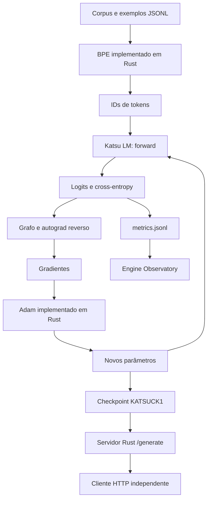

# Katsu: construção de um motor de treinamento em Rust

**Registro técnico — 24 de outubro de 2026.** Escopo: implementação local KATSU e telemetria ARANDU. Este documento reúne o estado inspecionado e resultados já registrados; não representa uma nova execução de todos os experimentos. Consulte o manifesto de evidências desta pasta para os arquivos e hashes utilizados.

## 1. O que foi construído

O Katsu é uma implementação própria de um motor de deep learning: representa tensores, executa operações numéricas, constrói um grafo computacional, calcula gradientes e atualiza parâmetros em Rust. O caminho nativo de treinamento inspecionado não delega essas tarefas ao PyTorch. Python coordena tarefas e integra o serviço; não executa o autograd do modelo.

A contribuição está na implementação e na integração dessas peças em um sistema controlado pelo projeto. Isso é diferente de escrever uma arquitetura usando `torch.Tensor`, `torch.autograd` e `torch.optim.Adam`: naquele caso, o motor de execução e diferenciação é fornecido pelo PyTorch. Aqui, essas responsabilidades estão em `katsu-core`.

“Motor próprio” não significa invenção do cálculo diferencial, do Transformer, de Adam ou de BPE. Também não prova ineditismo mundial, exclusividade comercial ou ausência de qualquer código de terceiros. Uma afirmação jurídica de autoria/proveniência integral exigiria uma auditoria específica do histórico, licenças e contribuições. O que este registro demonstra é onde o cálculo acontece e quais componentes o projeto mantém.

## 2. Três níveis que não devem ser confundidos

| Nível | No projeto | Evidência necessária |
|---|---|---|
| Motor | Tensores, kernels, autograd e otimizadores Rust | Código, dependências e testes numéricos |
| Modelo | Katsu LM: arquitetura e parâmetros treinados | Configuração, tokenizer, checkpoint e trajetória do treino |
| Interface | Arandu: configuração e telemetria | Testes da interface e leitura de métricas |

Um motor pode funcionar corretamente e treinar um modelo que ainda responde mal. Uma aplicação pode corrigir uma resposta do modelo sem melhorar os pesos. Os resultados abaixo preservam essas distinções.

## 3. Mapa do código

Os caminhos desta tabela são relativos à raiz KATSU, exceto quando indicado.

| Responsabilidade | Implementação |
|---|---|
| Dados, shapes, grafo e backward | `crates/katsu-core/src/tensor.rs` |
| Operações diferenciáveis | `crates/katsu-core/src/ops.rs` |
| Kernels e contrato de backend | `crates/katsu-core/src/backend.rs` |
| SIMD CPU | `crates/katsu-core/src/simd.rs` |
| SGD e Adam | `crates/katsu-core/src/optim.rs` |
| Modelo causal, geração, checkpoints | `crates/katsu-core/src/lm.rs` |
| BPE e IDs de instrução | `crates/katsu-core/src/bpe.rs` |
| CUDA opcional | `crates/katsu-core/src/cuda.rs` e `src/cuda/` |
| Treinador SFT nativo | `crates/katsu-server/src/bin/train_sft.rs` |
| Orquestração do SFT | `train_sft.py` |
| HTTP e parada de geração | `crates/katsu-server/src/main.rs` |
| Dataset e avaliação livre | `scripts/build_sft_arandu.py`, `scripts/eval_sft_http.py` |
| Exportação GGUF | `scripts/export_to_gguf.py` |
| Preparação do host NVIDIA | `hostinger_setup.sh`, `deploy/cuda/` |
| Telemetria | ARANDU: `arandu-web/training.py`, `arandu-desktop/src/DevDashboard.jsx` |

## 4. Fluxo de execução



### Tensores, memória e shapes

Os dados numéricos usam `f32`. O grafo tem `Tensor(Arc<TensorNode>)`; gradientes são armazenados sob `RwLock<Option<Vec<f32>>>`. As operações validam shapes e propagam erros, em vez de executar produtos incompatíveis silenciosamente.

O uso de Arc/RwLock permite compartilhar estruturas com sincronização. Não significa que todo o backward execute em paralelo: sincronização do grafo e paralelismo dos kernels são assuntos diferentes. Ownership ajuda a controlar acesso e vida útil; alocação, contagem de referências e locks continuam tendo custos em tempo de execução. Não foi escrito um alocador de memória do sistema do zero.

### Autograd reverso

O forward registra dependências entre operações. O backward percorre essas dependências em ordem reversa e aplica as derivadas locais, acumulando contribuições quando um parâmetro participa de vários caminhos. Para uma loss escalar, a derivada inicial é 1.

A existência de um grafo não basta para provar correção: os testes do core incluem verificações de gradientes e diferenças finitas em operações selecionadas. São evidências de implementação, não uma prova formal de todos os programas possíveis.

### Adam e ciclo de atualização

Adam mantém médias móveis do gradiente e do gradiente ao quadrado, com correção de viés:

```text
m = beta1*m + (1-beta1)*g
v = beta2*v + (1-beta2)*g²
m_hat = m / (1-beta1^passo)
v_hat = v / (1-beta2^passo)
w_novo = w - lr*m_hat/(sqrt(v_hat)+epsilon)
```

`Optimizer::step` retorna novos tensores folha. Os dados dos parâmetros anteriores permanecem imutáveis; o loop usa os novos parâmetros no passo seguinte. Não se deve documentar uma chamada fictícia `optimizer.zero_grad`: esse não é o contrato atual.

No SFT, os pesos são carregados do checkpoint, mas o estado de Adam é reiniciado. O campo `adam_state_resumed: false` documenta isso. Carregar pesos não equivale a retomar exatamente todo o estado de um treino.

### Modelo causal

O forward soma embeddings de tokens e posições aprendidas. Cada bloco aplica normalização, projeções Q/K/V, atenção causal escalada, conexões residuais e MLP com GELU; ao final, normalização e projeção para logits do vocabulário.

A máscara causal impede acesso a tokens futuros. Cada cabeça calcula sua contribuição e a projeta de volta ao espaço do modelo. As contribuições são somadas ao residual. A implementação não deve ser apresentada como reprodução binária exata de GPT-2.

A imagem de Transformer enviada pelo usuário mostra encoder e decoder. O Katsu LM inspecionado é causal, da família decoder-only: não contém aquele encoder separado e sua atenção cruzada. O diagrama da imagem é referência conceitual, não planta exata deste código.

## 5. Tokenizer próprio e compatibilidade

O BPE é implementado em Rust e usa uma base de bytes com merges aprendidos. “Próprio” descreve implementação e vocabulário treinado; BPE é um algoritmo conhecido. Treinar em textos PT-BR adapta o vocabulário às frequências do corpus, mas não prova compreensão da língua ou cobertura representativa do português brasileiro.

A versão anterior, KATSUBP1, foi mantida. KATSUBP2 reserva quatro tokens atômicos, sem modificar os IDs dos merges antigos:

| Token | ID no tokenizer desta execução |
|---|---:|
| `<|system|>` | 32000 |
| `<|user|>` | 32001 |
| `<|assistant|>` | 32002 |
| `<|end|>` | 32003 |

Os IDs são estáveis nesse vocabulário serializado; não são universais para qualquer tokenizer treinado com outro tamanho. A expansão de vocabulário copia as linhas antigas de embeddings e as colunas antigas da cabeça de saída, inicializando apenas as entradas novas. O relatório de migração registra a preservação dos pesos antigos. Novas classes podem alterar as probabilidades, mesmo quando os logits antigos são preservados.

O corpus literário local foi usado no desenvolvimento. Ainda é necessário manter um inventário completo de origem, licença, versão e divisão de cada obra antes de divulgar um dataset como auditado. Não há nesta documentação prova de uso de dados reais de atletas no treinamento; os exemplos SFT descritos são sintéticos.

## 6. Evolução e decisões

| Etapa | Problema tratado | Decisão e consequência |
|---|---|---|
| Core e autograd | Ter execução e gradientes sob controle do projeto | Implementar operações e backward em Rust |
| CPU e concorrência | Custo de matmul e compartilhamento do grafo | SIMD, Rayon e Arc/RwLock; custos e testes permanecem explícitos |
| Smoke e estabilidade | Verificar treinamento integrado | Modelo pequeno, checkpoints, loss e verificações de finitude |
| Contexto 16 → 256 | Prompts de integração excediam a janela | Expandir posições preservando as existentes; separar runs |
| SFT inicial | Modelo continuava gerando literatura | Exemplos de instrução e loss apenas na resposta |
| Tokens reservados | Marcadores eram texto BPE comum | Quatro IDs atômicos, migração de pesos e EOS explícito |
| Avaliação livre | Loss baixa não garantia acerto factual | Comparar respostas geradas com valores esperados |
| Preparação NVIDIA | Não há GPU disponível | Compilar caminho CUDA e preparar testes; não declarar runtime validado |

Esta é uma sequência de engenharia, não uma atribuição causal definitiva. A melhora de formato após tokens especiais ocorreu junto com mais exemplos e treinamento. Não isola o efeito dos tokens. Da mesma forma, erros numéricos não provam que uma camada seja incapaz de copiar números.

## 7. Experimentos e resultados registrados

### SFT com tokens especiais

Run: `runs/mac-sft-special-v1/`. Base: `runs/mac-context-256-adapted/`.

| Configuração | Valor |
|---|---:|
| Parâmetros | 2.069.088 |
| Camadas / cabeças / dimensão | 1 / 4 / 32 |
| Contexto | 256 tokens |
| Vocabulário | 32.004 |
| Exemplos de treino / avaliação | 302 / 10 |
| Passos / batch | 3.000 / 1 |
| Learning rate | 5e-4 |
| Loss média de treino, antes → depois | 10,09825 → 0,14959 |
| Loss média de avaliação, antes → depois | 10,06652 → 0,10163 |
| Tempo SFT registrado | 226,78 s |
| Verificações de finitude | Passaram |

O conjunto de avaliação é pequeno e restrito a prontidão. A loss é teacher-forced: cada previsão recebe os tokens anteriores corretos. Isso não equivale a gerar sozinho uma resposta exata.

Na avaliação HTTP de 10 casos em duas temperaturas, houve **20/20 paradas no EOS**, mas apenas **4/20 correspondências exatas**: 3/10 com temperatura 0 e 1/10 com temperatura 0,7. Os 20 resultados não são 20 perguntas independentes. Esse teste valida a parada e expõe a limitação factual; não aprova o modelo como assistente geral.

O verificador dessa etapa registra 67 testes Rust, 5 de exportação e 5 HTTP aprovados. São contagens daquela etapa. A alteração posterior do treinador registrou 2 testes específicos Rust, compilação com CUDA, Clippy e um smoke SFT CPU de um passo. Não se deve somar tudo como uma única suíte recém-executada.

### Telemetria e interpretação

O dashboard acompanha `metrics.jsonl` do run selecionado e apresenta passo, fase, loss e learning rate. Runs e fases são separados para não misturar objetivos distintos. Um passo é uma atualização do otimizador; uma época é uma passagem pelo conjunto de dados.

A loss histórica perto de 2,06 de outra execução não pode ser atribuída automaticamente ao tokenizer e ao contexto atuais. A referência ln(32000) pressupõe distribuição uniforme; não é uma prova de qual vocabulário foi usado. Uma subida de loss após alterar contexto também pode refletir outras mudanças e precisa ser investigada, não simplesmente batizada como “choque de contexto”.

## 8. O que significa independência do PyTorch

| Questão | Resposta fundamentada |
|---|---|
| Quem executa as operações do caminho nativo? | Kernels do Katsu, via seu contrato Backend |
| Quem calcula gradientes? | Autograd implementado em `tensor.rs` e operações associadas |
| Quem atualiza pesos? | Adam/SGD do Katsu |
| Python é necessário para a matemática? | O treinador é Rust; Python orquestra e integra |
| O projeto tem dependências externas? | Sim: Rayon; cudarc opcional; Axum/Tokio/Serde no serviço; PyO3 em binding separado |
| O algoritmo de treinamento é uma descoberta científica inédita? | Não há essa alegação; são métodos estabelecidos implementados no projeto |
| PyTorch é uma caixa-preta impossível de auditar? | Não. Sua documentação descreve autograd e seu código é aberto |
| Foi demonstrado que Katsu é mais rápido que PyTorch? | Não foi apresentado benchmark controlado entre ambos |
| Treino local elimina toda dependência estrangeira? | Não: hardware, compilador, bibliotecas e infraestrutura continuam na cadeia |

A documentação oficial do [autograd do PyTorch](https://docs.pytorch.org/docs/stable/notes/autograd) descreve seu próprio grafo e diferenciação reversa. A distinção é a implementação que executa o trabalho, não a exclusividade da regra da cadeia.

Os números históricos de matmul, aproximadamente 10,7 ms → 2,2 ms, descrevem uma comparação interna relatada entre caminhos CPU do Katsu. Sem protocolo e artefato completos nesta coleta, não são usados como benchmark principal nem como comparação com PyTorch. Para uma comparação publicável, registrar hardware, shapes, dtype, threads, aquecimento, repetições, dispersão, versões e sincronização, além da correção numérica.

## 9. GPU, escala e exportação

O CUDA opcional contém kernels para matmul, add e cross-entropy, incluindo gradientes. O restante do fluxo ainda inclui operações CPU e Adam no host, com transferências de buffers. É um backend híbrido experimental, não um trainer inteiramente residente na GPU.

`hostinger_setup.sh` constrói o ambiente e exige os testes GPU antes de iniciar o SFT. Requer host Linux com NVIDIA, driver, Docker e Container Toolkit; não provisiona nem aluga servidor. Nenhum teste em NVIDIA foi executado nesta entrega.

O perfil de 12 camadas, 768 dimensões, 12 heads, contexto 256 e vocabulário 32004 tem **134.373.888 parâmetros**. “139M” é uma designação aproximada; o perfil histórico do core usa 13 camadas. Checkpoints de arquiteturas diferentes não são intercambiáveis.

Sem base compatível, o script inicializa pesos aleatórios para smoke de infraestrutura. Os 302 exemplos não substituem pré-treinamento amplo. Mais camadas, sozinhas, não garantem cópia correta ou raciocínio.

O checkpoint nativo usa KATSUCK1. O exportador GGUF preserva pesos e metadados do BPE especial, mas registra arquitetura própria `katsu`. Gerar um arquivo GGUF não garante que llama.cpp saiba executá-lo; é necessário suporte à arquitetura e à tokenização.

## 10. Como reproduzir e conferir

Na raiz KATSU, com ambiente Rust e dependências disponíveis:

```bash
cargo test --locked -p katsu-core
cargo test --locked -p katsu-server --bin train_sft
cargo check --locked -p katsu-server --features cuda --bin train_sft
python3 train_sft.py --base runs/mac-context-256-adapted \
  --output runs/repro-sft-special --steps 3000 --learning-rate 0.0005
```

O diretório de saída deve ser novo. A reprodução exige exatamente os mesmos dados, tokenizer e checkpoint base; o código sozinho não recompõe os artefatos privados/locais. Seeds fixas não prometem igualdade bit a bit entre plataformas e kernels paralelos.

A compilação da feature CUDA no Mac verifica apenas o caminho compilável nessa plataforma; não valida compilação/execução dos kernels em Linux/NVIDIA. Consulte `docs/hostinger-sft.md` para o fluxo do host.

## 11. Referências e uso das imagens

As capturas enviadas mostram material de referência: o artigo de GPT-2 e o diagrama clássico do Transformer. Elas não documentam experimentos Katsu. Este dossiê usa um diagrama próprio do fluxo inspecionado e não reutiliza os gráficos como resultados do projeto.

- Vaswani et al. (2017), [Attention Is All You Need](https://arxiv.org/abs/1706.03762): fundamento da arquitetura Transformer. O desenho encoder–decoder deve ser distinguido do modelo causal implementado aqui.
- Radford et al. (2019), [Language Models are Unsupervised Multitask Learners](https://cdn.openai.com/better-language-models/language-models.pdf): referência histórica para modelos de linguagem e avaliação de transferência. Seus resultados de escala não demonstram desempenho do Katsu.
- [PyTorch: Autograd mechanics](https://docs.pytorch.org/docs/stable/notes/autograd): descrição pública do mecanismo de diferenciação do framework usado na comparação conceitual.

## 12. Texto público recomendado

> O Katsu é um motor de deep learning desenvolvido em Rust, com implementação própria de tensores, diferenciação automática reversa, kernels numéricos, otimizadores e um modelo de linguagem causal. Seu caminho nativo de treinamento não depende do PyTorch. O projeto aplica métodos conhecidos da literatura e já demonstrou treinamento, checkpoints e integração HTTP em CPU. As avaliações também expõem seus limites: o modelo pequeno ainda erra dados e sua saída precisa de avaliação independente antes de uso. A execução CUDA e o treinamento em maior escala permanecem etapas a validar.

Essa formulação atribui valor ao trabalho de engenharia sem confundir implementação própria com invenção de todos os fundamentos ou com desempenho ainda não demonstrado.


## Escopo independente

Katsu e Arandu não dependem de outro projeto de aplicação. Conectores externos e seus relatórios foram removidos desta documentação e dos caminhos ativos. Os registros originais foram arquivados sem reescrever seus resultados. O pacote de evidências atual identifica apenas fontes e resultados do motor.
